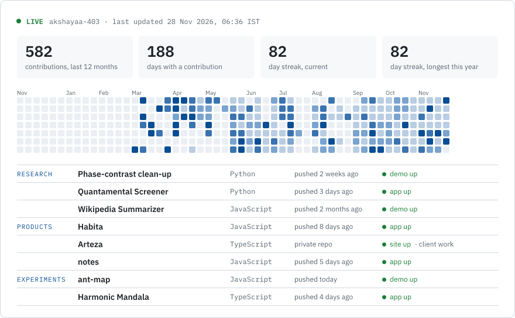

<h3>Akshayaa Kashyap</h3>

<samp><a href="https://akshayaa-403.github.io/portfolio/">portfolio</a> · <a href="https://linkedin.com/in/akshayaa-kashyap">linkedin</a> · <a href="https://akshayaakashyap.substack.com">substack</a> · <a href="https://akshayaa-403.github.io/portfolio/public/assets/resume.pdf">resume</a> · akshayaakashyap5@gmail.com</samp>

<picture>
  <source media="(prefers-color-scheme: dark)" srcset="https://raw.githubusercontent.com/akshayaa-403/akshayaa-403/output/dashboard-dark.svg">
  
</picture>

<table>
<tr>
<td><b>Research</b></td>
<td width="30%" valign="top"><b><a href="https://github.com/akshayaa-403/phase-contrast-denoising">Phase-contrast clean-up</a></b> Halo removal for microscopy; Otsu Dice 0.08 → 0.94 on 30 held-out synthetic frames, 0.10 → 0.61 on real cells. <a href="https://akshayaa-403.github.io/phase-contrast-denoising/">demo</a> · <a href="https://akshayaa-403.github.io/portfolio/work/phase-contrast-denoising.html">case study</a></td>
<td width="30%" valign="top"><b><a href="https://github.com/akshayaa-403/quantamental-screener">Quantamental Screener</a></b> S&amp;P 500 ranked on four factors; beat the index in backtest, but not luck (p = 0.07). <a href="https://quantamental-screener.streamlit.app">app</a> · <a href="https://akshayaa-403.github.io/portfolio/work/quantamental-screener.html">case study</a></td>
<td width="30%" valign="top"><b><a href="https://github.com/akshayaa-403/Wikipedia-Summarizer">Wikipedia Summarizer</a></b> Four summarisers scored against the human-written lead. <a href="https://akshayaa-403.github.io/Wikipedia-Summarizer/">demo</a> · <a href="https://github.com/akshayaa-403/Wikipedia-Summarizer#how-well-do-they-work">results</a></td>
</tr>
<tr>
<td><b>Products</b></td>
<td valign="top"><b><a href="https://github.com/akshayaa-403/Habita">Habita</a></b> Eisenhower matrix that writes to your phone's calendar. <a href="https://akshayaa-403.github.io/Habita/src/index.html">app</a> · <a href="https://akshayaa-403.github.io/portfolio/work/habita.html">case study</a></td>
<td valign="top"><b><a href="https://arteza.site">Arteza</a></b> Storefront for an original-art studio (client work, private repo). <a href="https://arteza.site">live</a> · <a href="https://akshayaa-403.github.io/portfolio/work/arteza.html">case study</a></td>
<td valign="top"><b><a href="https://github.com/akshayaa-403/notes">notes</a></b> Boards of cards, a picture calendar, a pomodoro timer and a PDF bookshelf; works offline, your data stays on your device. <a href="https://akshayaa-403.github.io/notes/">app</a></td>
</tr>
<tr>
<td><b>Experiments</b></td>
<td valign="top"><b><a href="https://github.com/akshayaa-403/anttodo">anttodo</a></b> Ant colony optimisation over a day's tasks. <a href="https://akshayaa-403.github.io/anttodo/">demo</a></td>
<td valign="top"><b><a href="https://github.com/akshayaa-403/music-player">Harmonic Mandala</a></b> Turns a Spotify track's tempo, key, energy and mood into six rotating wave rings that pulse with playback.</td>
<td valign="top"></td>
</tr>
</table>
